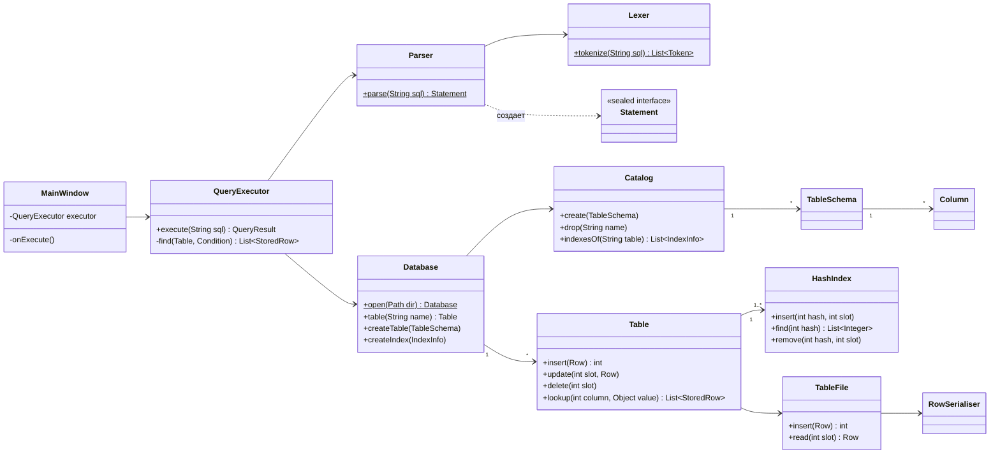
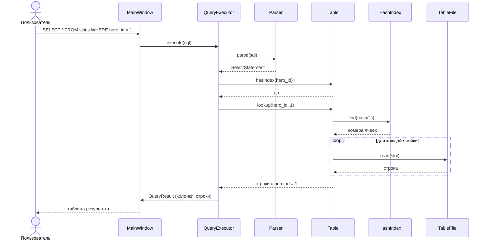

# mini-dbms

Упрощенная СУБД на Java: SQL-подобный язык запросов, хранение таблиц в файлах, хеш-индексы и графический интерфейс на Swing.

Продолжение [работы](https://github.com/daysonee/file-based-db) по файловой базе данных. Оттуда взяты идеи хранения записей фиксированной длины, списка свободных ячеек и хеш-индекса на диске, а также основа интерфейса.

## Содержание

1. [Предметная область](#предметная-область)
2. [Возможности](#возможности)
3. [Архитектура](#архитектура)
4. [Хранение данных](#хранение-данных)
5. [Индексы и сложность операций](#индексы-и-сложность-операций)
6. [Восстановление после сбоя](#восстановление-после-сбоя)
7. [Тестирование производительности](#тестирование-производительности)
8. [Инструкция пользователя](#инструкция-пользователя)
9. [Источники](#источники)

## Предметная область

Каталог героев и скинов Dota 2. Две таблицы связаны по ключу: каждый скин относится к герою.

```sql
CREATE TABLE heroes (id INT PRIMARY KEY, name STRING(30) NOT NULL, released DATE, melee BOOLEAN);
CREATE TABLE skins  (id INT PRIMARY KEY, name STRING(40), hero_id INT REFERENCES heroes(id), price DOUBLE);
```

Используются пять типов данных: `INT`, `DOUBLE`, `STRING(n)`, `DATE` (формат `'ГГГГ-ММ-ДД'`), `BOOLEAN`.

Таблицы с любой структурой создаются запросом `CREATE TABLE`.

## Возможности

| Запрос | Пример |
|---|---|
| `CREATE TABLE` | `CREATE TABLE cars (id INT PRIMARY KEY, brand STRING(20) NOT NULL, price DOUBLE, sold BOOLEAN);` |
| `DROP TABLE` | `DROP TABLE cars;` |
| `INSERT` одной или нескольких строк, с перечислением колонок или без | `INSERT INTO cars VALUES (1, 'Toyota', 25000.0, TRUE), (2, 'BMW', 30000, FALSE);`<br>`INSERT INTO cars (id, brand) VALUES (3, 'Audi');` |
| `SELECT` всех или выбранных колонок, с условием или без | `SELECT brand, price FROM cars WHERE price > 20000;` |
| `UPDATE` по условию | `UPDATE cars SET price = 30000 WHERE id = 2;` |
| `DELETE` по условию | `DELETE FROM cars WHERE brand = 'Toyota';` |
| `CREATE INDEX` | `CREATE INDEX idx_cars_brand ON cars (brand);` |

Операторы сравнения в `WHERE`: `=`, `!=`, `<>`, `<`, `<=`, `>`, `>=`. Значения: целые и дробные числа, строки в одинарных кавычках (кавычка внутри строки удваивается: `'O''Brien'`), `TRUE`, `FALSE`, `NULL`. Регистр ключевых слов и имен не важен.

Проверяемые ограничения целостности:

- уникальность первичного ключа, в том числе внутри одного `INSERT` с несколькими строками;
- `NOT NULL`, тип значения, длина строки;
- внешний ключ (`REFERENCES`): нельзя вставить ссылку на несуществующую строку, удалить строку, на которую ссылаются, или удалить таблицу, на которую ссылается другая.

Запрос с несколькими строками выполняется целиком или не выполняется вовсе: сначала проверяются все строки, и только потом они записываются.

## Архитектура

Запрос проходит через слои сверху вниз. Каждый слой знает только о слое под ним.

```
MainWindow                      ввод запроса, вывод результата (Swing)
    │
    ▼
QueryExecutor ──► Parser ──► Lexer
    │             текст запроса → токены → объект запроса (Statement)
    │
    │             выполнение запроса, проверка ограничений, выбор индекса
    ▼
Database ──────► Catalog ──► TableSchema ──► Column ──► DataType
    │             описание таблиц и индексов (catalog.bin)
    ▼
Table                           строки одной таблицы и её индексы
    ├──► TableFile ──► RowSerialiser    ячейки в файле .tbl
    └──► HashIndex                      хеш-индекс в файле .idx
```

| Пакет | Классы | Назначение |
|---|---|---|
| `schema` | `DataType`, `Column`, `TableSchema`, `Catalog`, `IndexInfo` | типы данных, описание таблиц и индексов, их хранение |
| `storage` | `Row`, `RowSerialiser`, `TableFile`, `StoredRow`, `HashIndex`, `Table` | хранение строк и индексов в файлах |
| `sql` | `Lexer`, `Token`, `Parser`, `Condition`, `Operator`, `SqlScript`, `statements.*` | разбор запросов |
| `engine` | `Database`, `QueryExecutor`, `QueryResult` | выполнение запросов |
| `ui` | `MainWindow`, `ResultTableModel` | графический интерфейс |

Использованные паттерны:

- **DAO** — `Table`: все операции со строками одной таблицы и поддержка ее индексов в одном классе.
- **Facade** — `Database`: единая точка доступа к каталогу и таблицам.
- **Iterator** — `TableFile` и `Table` реализуют `Iterable<StoredRow>` и перебираются циклом `for`, пропуская свободные ячейки.
- **Interpreter** — разбор запроса в дерево объектов (`Statement`) и его выполнение.

### Диаграмма классов



### Диаграмма последовательности: `SELECT` по индексу



Если по колонке нет индекса или оператор не `=`, исполнитель вместо `lookup` перебирает все строки `Table` итератором.

## Хранение данных

База является папкой с файлами:

| Файл | Содержимое |
|---|---|
| `catalog.bin` | схемы всех таблиц и список индексов |
| `<таблица>.tbl` | строки таблицы |
| `<таблица>.pk.idx` | индекс по первичному ключу (создается вместе с таблицей) |
| `<таблица>.<индекс>.idx` | индекс из `CREATE INDEX` |
| `db.open` | метка «база открыта», см. [восстановление](#восстановление-после-сбоя) |

**Файл таблицы** состоит из заголовка (метка файла, размер ячейки, число ячеек, число строк, первая свободная ячейка) и ячеек фиксированного размера. Размер ячейки вычисляется по схеме, поэтому адрес ячейки `i` равен `заголовок + i · размер`, и ячейка читается за O(1).

```
[статус 1 байт][битовая маска NULL][колонка 0][колонка 1]...[колонка n-1]
```

- `INT` — 4 байта, `DOUBLE` — 8, `BOOLEAN` — 1, `DATE` — 8 (число дней с 1970-01-01), `STRING(n)` — 2n;
- бит `i` маски равен 1, если в колонке `i` значение `NULL`; маска занимает `⌈n / 8⌉` байт;
- строка записывается и читается одним обращением к файлу: значения собираются в массив байт через `ByteBuffer`.

Удаленная ячейка помечается свободной и попадает в список свободных ячеек: в ней хранится номер следующей свободной. Вставка сначала занимает свободную ячейку и только если таких нет, дописывает строку в конец файла. Строки при удалении не сдвигаются.

**Каталог** записывается целиком при каждом `CREATE`/`DROP`. Сначала во временный файл, затем он атомарно переименовывается в `catalog.bin`. На диске всегда лежит либо старая, либо новая полная версия каталога.

## Индексы и сложность операций

`HashIndex` — хеш-таблица на диске с открытой адресацией и линейным пробированием. Слот хранит состояние (пустой / занят / удален), хеш значения и номер ячейки в файле таблицы. Хранится хеш, а не само значение, поэтому слоты имеют одинаковый размер для любого типа колонки; совпадения хешей у разных значений отсеиваются сравнением с самой строкой таблицы. Одно значение может встречаться много раз, поэтому поиск возвращает все подходящие ячейки. Удаленная запись помечается как удаленная (tombstone), чтобы не обрывать цепочку пробирования. Когда таблица заполнена больше чем на 70%, ее размер удваивается.

Индекс по первичному ключу создается автоматически. Индексы обновляются при каждом `INSERT`, `UPDATE` и `DELETE`. Значения `NULL` в индекс не попадают.

Индекс используется для условия `колонка = значение`, если по колонке есть индекс. Для `<`, `>` и других сравнений хеш-индекс не подходит: значения в нем не упорядочены, поэтому выполняется полный перебор. В строке состояния интерфейса видно, какой способ был выбран.

n — число строк в таблице, k — число найденных строк.

| Операция | Без индекса | С индексом |
|---|---|---|
| поиск по первичному ключу | O(n) | O(1) |
| проверка уникальности ключа при вставке | O(n) | O(1) |
| проверка внешнего ключа | O(n) | O(1) |
| `WHERE колонка = значение` | O(n) | O(1 + k) |
| `WHERE колонка > значение` | O(n) | O(n) |
| вставка строки | — | O(1) в среднем + O(1) на каждый индекс |
| `CREATE INDEX` | — | O(n), один раз |

## Восстановление после сбоя

- При открытии базы создается файл `db.open`, при нормальном закрытии он удаляется. Если при открытии он уже есть, прошлый запуск завершился аварийно. Тогда все индексы перестраиваются по файлам таблиц: файл таблицы считается основным источником данных, а индекс всегда можно восстановить из него. Интерфейс сообщает о восстановлении.
- Если файла индекса нет, он тоже строится заново.
- Если файла таблицы нет, создается пустая таблица.
- Недописанный временный файл каталога после сбоя удаляется при открытии.

## Тестирование производительности

Класс `Benchmark` создает таблицу `skins (id INT PRIMARY KEY, name STRING(20), price DOUBLE)` из n строк и замеряет одни и те же запросы до и после `CREATE INDEX idx_skins_name ON skins (name)`. Все операции выполняются через SQL, поэтому в замер входит и разбор запроса. Время запроса — среднее по 1000 запросов через индекс и по 20 запросов с полным перебором. Перед замерами выполняется прогрев на 1000 строках.

Компьютер: MacBook Air (Apple Silicon), Java 21.

| Строк | Вставка, мкс/строка | `id =` (индекс ключа), мс | `name =` без индекса, мс | `name =` с индексом, мс | Ускорение | `price >` (перебор), мс |
|---:|---:|---:|---:|---:|---:|---:|
| 1 000 | 106,2 | 0,018 | 2,32 | 0,014 | ×167 | 1,46 |
| 10 000 | 76,3 | 0,016 | 15,30 | 0,018 | ×866 | 15,94 |
| 50 000 | 81,0 | 0,012 | 86,46 | 0,011 | ×7576 | 79,36 |

- Поиск без индекса растет пропорционально числу строк: в 50 раз больше строк — примерно в 37 раз дольше. Это полный перебор, O(n).
- Поиск через индекс занимает 0,011–0,018 мс и не зависит от размера таблицы: O(1). На 50 000 строк он быстрее перебора в 7576 раз.
- Поиск по первичному ключу всегда идет через индекс и тоже не зависит от размера таблицы.
- `price >` выполняется перебором и растет так же, как поиск без индекса: хеш-индекс не помогает для диапазонов.
- Время вставки не растет с размером таблицы: уникальность ключа проверяется через индекс, а не перебором. Вставка заметно дороже поиска, потому что каждая строка записывается в файл таблицы и в индекс, а их заголовки обновляются на диске.

Запуск замеров: `mvn compile exec:java -Dexec.mainClass=ru.daysonee.dbms.Benchmark`.

## Инструкция пользователя

Нужны JDK 21 и Maven.

```
mvn compile exec:java
```

Откроется окно с базой в папке `data` (создается автоматически). Другую папку можно открыть через **Файл → Открыть базу** или передать аргументом: `mvn compile exec:java -Dexec.args="путь/к/папке"`.

Работа в окне:

- запрос вводится в верхнее поле и выполняется кнопкой **Выполнить** или `Ctrl+Enter`;
- в поле можно написать несколько запросов через `;`, они выполнятся по очереди; если выделить часть текста, выполнится только она;
- результат последнего `SELECT` показывается в таблице, сортировка — щелчком по заголовку колонки;
- в строке состояния — сообщение последнего запроса (например, «Найдено строк: 2 (по индексу)») и время выполнения;
- слева список таблиц, двойной щелчок по таблице выполняет `SELECT * FROM таблица`;
- **Справка → Пример запросов** подставляет готовый сценарий: создание таблиц, вставку, индекс и выборку;
- ошибки (синтаксис, нарушение ограничений, неверный тип) показываются в окне сообщения, программа продолжает работу.

Пример сценария:

```sql
CREATE TABLE heroes (id INT PRIMARY KEY, name STRING(30) NOT NULL, released DATE, melee BOOLEAN);
CREATE TABLE skins (id INT PRIMARY KEY, name STRING(40), hero_id INT REFERENCES heroes(id), price DOUBLE);
INSERT INTO heroes VALUES (1, 'Pudge', '2004-01-01', TRUE), (2, 'Lina', '2004-01-01', FALSE);
INSERT INTO skins VALUES (10, 'Dragonclaw Hook', 1, 950.0), (11, 'Fiery Soul', 2, 25.0), (12, 'Feast', 1, 27.0);
CREATE INDEX idx_skins_hero ON skins (hero_id);
SELECT name, price FROM skins WHERE hero_id = 1;      -- по индексу
SELECT * FROM skins WHERE price > 26;                 -- полный перебор
UPDATE skins SET price = 30 WHERE id = 11;
DELETE FROM heroes WHERE id = 1;                      -- ошибка: на героя ссылаются скины
DELETE FROM skins WHERE hero_id = 1;
DELETE FROM heroes WHERE id = 1;                      -- теперь можно
```

Автотесты (JUnit 5, 24 теста: типы, схема, каталог, файл таблицы, лексер, парсер, выполнение запросов): `mvn test`.

### Ограничения

- `WHERE` содержит одно условие, без `AND`/`OR`; `JOIN`, сортировка и агрегатные функции не поддерживаются.
- Первичный ключ нельзя изменить через `UPDATE`.
- Хеш-индекс ускоряет только условие `=`.
- Строка не длиннее 255 символов.


## Источники

1. Let's Build a Simple Database — пошаговое создание клона SQLite: разбор запросов, хранение строк в файле, индекс. — https://cstack.github.io/db_tutorial/ (исходный код: https://github.com/cstack/db_tutorial)
2. Build your own X: Database — подборка руководств по созданию своей СУБД. — https://github.com/codecrafters-io/build-your-own-x
3. Smith J. Build Your Own Database From Scratch — хранение на диске, индексы, язык запросов (первая часть доступна онлайн). — https://build-your-own.org/database/
4. Как создать свою СУБД с нуля и не сойти с ума. Часть первая // Хабр, 2023. — https://habr.com/ru/post/709234
5. Подсистемы хранения и извлечение данных. Конспект книги «Designing Data-Intensive Applications» // Хабр, 2021. — https://habr.com/ru/post/557014
6. Реализация словаря в Python (открытая адресация, удаление, расширение таблицы) // Хабр, 2019. — https://habr.com/ru/post/448350/
7. Парсер формул с помощью метода рекурсивного спуска (на Java) // Хабр, 2011. — https://habr.com/ru/post/122397/
8. Nystrom R. Crafting Interpreters: Parsing Expressions. — https://craftinginterpreters.com/parsing-expressions.html
9. Architecture of SQLite. — https://sqlite.org/arch.html
10. PostgreSQL Documentation: Hash Indexes. — https://www.postgresql.org/docs/13/hash-index.html
11. Jenkov J. Java IO Tutorial: RandomAccessFile — чтение и запись файла по смещению. — https://jenkov.com/tutorials/java-io/randomaccessfile.html
12. The Java Tutorials: Creating a GUI With Swing. — https://docs.oracle.com/javase/tutorial/uiswing/
13. JUnit 5 User Guide. — https://junit.org/junit5/docs/current/user-guide/
